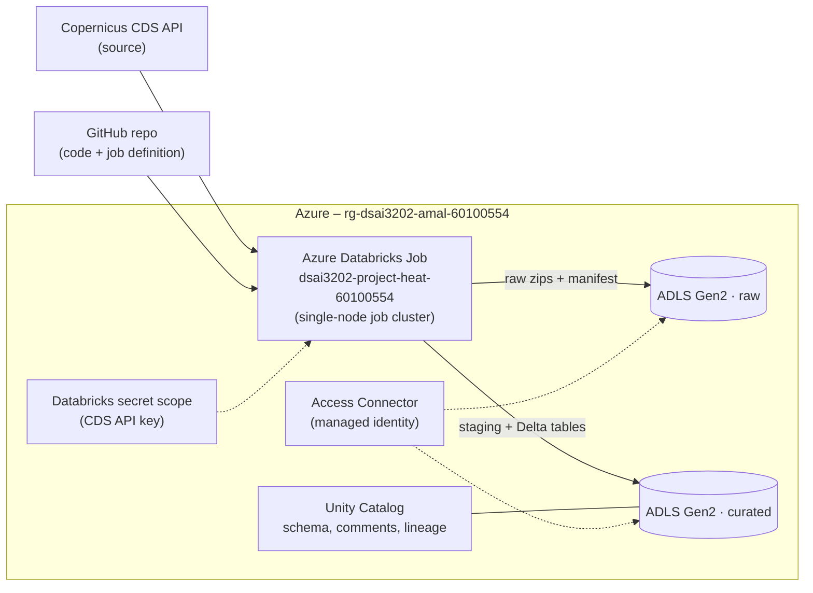

# Predicting tomorrow's heat stress in Doha – Phase 1: data pipeline, ETL and features

DSAI3202 Fall 2026 · Individual project · Amal Haji – 60100554
**Submitted commit / release:** ⟨TODO: tag `v1.0-phase1` and commit hash⟩

> Every ⟨TODO⟩ is filled in from my own job runs. Step-by-step instructions: [`STEP_BY_STEP_GUIDE.md`](STEP_BY_STEP_GUIDE.md).

---

## Project and hypothesis

**Problem.** Qatar's rules stop outdoor work when the wet-bulb globe temperature (WBGT) is above **32.1 °C**. Site
managers plan tomorrow's outdoor work today. The system predicts **tomorrow's maximum WBGT in Doha** from today's
weather around Qatar and flags days likely to go above 32.1 °C.

**Target.** `target_wbgt_max_next_day` – the highest hourly WBGT in Doha on day D+1 (Qatar local day), calculated from
temperature and dewpoint with the simplified Bureau of Meteorology formula `WBGT = 0.567·T + 0.393·e + 3.94`.

**Baseline plan.** "Tomorrow = today" (persistence), stored as `baseline_persistence` in the feature table.

**Hypothesis (Part 0).** A random forest / gradient-boosted model using today's weather from several locations around
Qatar will predict tomorrow's maximum WBGT in Doha with an MAE at least **10 % lower** than the baseline on the
May–October days of 2022–2025. A smaller improvement refutes it.

**Refinements.** Topic, dataset, target and hypothesis are unchanged from Part 0. One implementation change: Part 0
mentioned possibly reusing the Data Factory setup; ingestion is instead done in a Databricks job because the Copernicus
API queues each request (sometimes for minutes), which the `cdsapi` client handles. ⟨TODO: add anything else you change
after seeing the data — original wording / new wording / reason.⟩

---

## Dataset and architecture

| Item | Value |
|---|---|
| Dataset | ERA5 hourly time-series data on single levels from 1940 to present (Copernicus C3S), DOI 10.24381/1cf1ad76 |
| Source link | https://cds.climate.copernicus.eu/datasets/reanalysis-era5-single-levels-timeseries |
| Licence | CC-BY 4.0 (free account) |
| Selection | 35 grid points (lat 24.50–26.00, lon 50.75–51.75, step 0.25°), hourly, 1980-01-01 → 2025-12-31 |
| Variables | 2 m temperature, 2 m dewpoint, 10 m wind (u, v), surface pressure, solar radiation, total cloud cover |
| Format | CSV delivered zipped, one file per point |
| Expected size | 35 × 403,248 hours ≈ **14.1 million rows**, ≈ 1.4–1.5 GB uncompressed CSV (estimate) |
| Measured size | compressed: ⟨TODO from `_manifest.json` → `total_bytes_compressed`⟩ · uncompressed CSV: ⟨TODO: size of the staging folder⟩ |
| Version | raw `source_version=v1`; Delta table versions per run are in `heat_run_log` |

**Ingestion mode and refresh.** Batch, one API request per grid point. The period is historical and final, so it is
ingested once. A refresh (e.g. adding 2026) runs the job with a new `source_version` (`v2`); `v1` is never changed.

**Storage layout** (lake `amazonlake60100554`)
```
raw/heat_project/
  era5_timeseries/source_version=v1/
    _manifest.json                    <- identity, request, bytes and SHA-256 of every file
    lat25.25_lon51.50/data.zip        <- original file (never overwritten)
    lat25.25_lon51.50/_receipt.json
    ... 35 points
  test_inputs/bad_sample_v1/era5_bad_sample.csv   <- separate test input
curated/heat_project/
  staging/era5_csv/source_version=v1/<point>.csv  <- unzipped copy (can be rebuilt)
  delta/heat_silver_weather_hourly | heat_silver_weather_rejects | heat_gold_daily_weather | heat_features_v1 | heat_run_log
```

**Schema.** Columns, types, keys and assumptions: [`docs/catalog_and_lineage.md`](docs/catalog_and_lineage.md).

**Architecture**

| Service | Role |
|---|---|
| Azure Databricks job + job cluster | runs ingestion, ETL, quality gate, gold and features as one 5-task job |
| ADLS Gen2 `amazonlake60100554` | raw (immutable, versioned) and curated (staging + Delta) storage |
| Unity Catalog | table registration, column documentation, lineage |
| Access Connector | managed-identity access from Databricks to the lake (no keys in code) |
| Databricks secret scope | holds the CDS API key |

---

## Run the pipeline

**Prerequisites and permissions**
1. Copernicus CDS account; accept the ERA5 licence on the dataset page; copy your API token from your profile.
2. Databricks workspace `dsai3202-databricks` with `USE CATALOG` on `dsai3202_databricks`, `CREATE TABLE` on
   `s_60100554`, and an external location for the `raw` and `curated` containers with `READ FILES` / `WRITE FILES`
   (Access Connector, set up in Labs 5–6).
3. Check names in [`conf/project_config.json`](conf/project_config.json).

**Dependencies.** Databricks Runtime 15.4 LTS + `cdsapi` (installed by the job). See [`requirements.txt`](requirements.txt).
Local unit tests: `python tests/test_heat_formulas.py`.

**Configuration (no secrets in the repo)**
```bash
databricks secrets create-scope heat-project
databricks secrets put-secret heat-project cds-api-key      # paste the CDS token when asked
```
Upload the test input to `raw/heat_project/test_inputs/bad_sample_v1/era5_bad_sample.csv` (portal Storage browser or):
```bash
az storage fs file upload --auth-mode login --account-name amazonlake60100554 -f raw \
  --path heat_project/test_inputs/bad_sample_v1/era5_bad_sample.csv \
  --source tests/data/bad_sample_v1/era5_bad_sample.csv
```

**Execution**
1. Run `notebooks/00_smoke_test` interactively once (one month, Doha only).
2. Create and run the job:
```bash
databricks jobs create --json @jobs/heat_pipeline_job.json                                     # prints job_id
databricks jobs run-now <job_id>                                                                # 1) prod run
databricks jobs run-now <job_id>                                                                # 2) safe rerun
databricks jobs run-now --json '{"job_id": <job_id>, "job_parameters": {"run_mode": "test"}}'   # 3) controlled failure
```
3. Run `notebooks/06_eda` interactively and export it as HTML.

Task order: `01_ingest → 02_silver → 03_validate → 04_publish_gold → 05_features` (04 and 05 run only if 03 passes).

---

## Results and features

**Runs** (`SELECT run_id, task, status, metrics_json FROM dsai3202_databricks.s_60100554.heat_run_log ORDER BY logged_at`,
exported to [`run_log.csv`](docs/evidence/run_log.csv))

| Run | run_id | Result | Evidence |
|---|---|---|---|
| 1 – prod | ⟨TODO⟩ | all tasks SUCCESS / PASSED | [screenshot](docs/evidence/job_run_prod_1.png) |
| 2 – rerun | ⟨TODO⟩ | SUCCESS, `downloaded_this_run = 0`, `skipped = 35`, same counts | [screenshot](docs/evidence/job_run_prod_2_rerun.png) |
| 3 – test | ⟨TODO⟩ | 03_validate FAILED (`reject_rate_ok`), 04/05 not run | [screenshot](docs/evidence/job_run_test_failed.png) |

**Output paths and versions**

| Output | Path / table | Version |
|---|---|---|
| Raw | `raw/heat_project/era5_timeseries/source_version=v1/` + [`_manifest.json`](docs/evidence/_manifest.json) | v1 |
| Silver | `heat_silver_weather_hourly` | Delta ⟨TODO⟩ |
| Gold | `heat_gold_daily_weather` | Delta ⟨TODO⟩ |
| Features | `heat_features_v1` | Delta ⟨TODO⟩ |

**Row accounting (run 1)** – input = accepted + rejected + duplicates_dropped

| Input | Accepted | Rejected (by reason) | Duplicates dropped | Balanced |
|---|---|---|---|---|
| ⟨TODO⟩ | ⟨TODO⟩ | ⟨TODO⟩ | ⟨TODO⟩ | ⟨TODO⟩ |

Gold: ⟨TODO⟩ daily rows; ⟨TODO⟩ incomplete days dropped (expected: first/last day per point, from the UTC+3 shift).
Features: ⟨TODO⟩ rows (train ⟨TODO⟩ / validation ⟨TODO⟩ / test ⟨TODO⟩).

**When a quality failure stops publication.** `03_validate` stops the job, leaving gold and features unchanged, if:
row accounting is not balanced · reject rate > 1 % · duplicate keys in silver · not all 35 points (incl. Doha) present ·
any point has < 99 % of expected hours. Row rules in `02_silver`: rows failing type casting, missing time / location /
temperature / dewpoint, or outside physical ranges (temperature −10…60 °C, dewpoint above temperature, pressure
850–1100 hPa, etc.) go to `heat_silver_weather_rejects`; duplicate keys keep one row. Missing optional values (wind,
pressure, radiation, cloud) stay null rather than being invented.

**Safe rerun.** Raw files already present are never downloaded or overwritten; silver, gold and features are rebuilt
deterministically from the same raw version, so a rerun gives the same counts with no duplicates; Delta history keeps
earlier versions.

**Controlled failure.** Separate test input [`tests/data/bad_sample_v1/`](tests/data/bad_sample_v1/) (made by
[`tests/make_bad_sample.py`](tests/make_bad_sample.py)): 116 rows – 96 good, 10 duplicates, 4 missing temperature,
3 text in a number column, 3 impossible values. Expected: 10 rejected (8.6 %) → gate fails on `reject_rate_ok`.
Test runs write only to `*_test` tables.

**EDA findings** (full population, no sampling – [`06_eda.html`](docs/evidence/06_eda.html))
- Populations: ⟨TODO⟩
- Target distribution and alert share by month: ⟨TODO⟩
- Strongest correlations with the label: ⟨TODO⟩
- Outliers (IQR rule): ⟨TODO⟩
- Persistence MAE (May–Oct): train ⟨TODO⟩ / validation ⟨TODO⟩ / test ⟨TODO⟩ °C
- **Data risks and effect on modelling:** ⟨TODO – in your own words, e.g. alert days are most summer days (imbalance),
  possible warming trend (test years hotter than training), today and tomorrow are very similar (baseline hard to beat),
  WBGT is a simplified estimate, the Doha cell partly covers sea.⟩

**Initial features** – full definitions: [`features/features_v1_spec.yaml`](features/features_v1_spec.yaml)

| Feature | Type | Source | Available at prediction time |
|---|---|---|---|
| doha_wbgt_max, doha_wbgt_change_1d | double °C | gold, Doha | yes – day D / D-1 |
| doha_t_max, doha_td_mean | double °C | gold, Doha | yes – day D |
| doha_u_mean, doha_v_mean | double m/s | gold, Doha | yes – day D |
| doha_sp_change_1d | double hPa | gold, Doha | yes – day D / D-1 |
| region_wbgt_max_mean, region_td_mean | double °C | gold, 35 points | yes – day D |
| region_u_mean, region_v_mean | double m/s | gold, 35 points | yes – day D |
| doy_sin, doy_cos | double | date | yes |

**Leakage risks:** a feature taken from day D+1; a random split; scalers fitted on all years; mixing UTC and Qatar days.
The first, second and fourth are prevented in code; the third is a rule for Phase 2. No feature selection in v1.

**Sample for modelling.** None: the feature table (~16,800 rows) is used in full.

---

## Resource use and contributions

**Cost/performance choice: a single-node job cluster (Standard_DS3_v2) that exists only while the job runs.**
About 1.5 GB of CSV fits on one node, so workers would add cost without speed; most ingestion time is waiting in the
CDS queue, not computing.
- Measured: run 1 ⟨TODO⟩ min, rerun ⟨TODO⟩ min; raw zips ⟨TODO⟩ MB vs silver Delta ⟨TODO⟩ MB vs gold Delta ⟨TODO⟩ MB (logged by `04_publish_gold`).
- Estimate: run hours × (VM price + DBU price) = ⟨TODO from the Azure pricing calculator⟩.

**Cleanup.** The job cluster stops automatically after each run. After grading: drop the `*_test` tables and delete
`curated/heat_project/staging/` (rebuildable from raw); keep raw `v1`, the Delta tables and the job for Phase 2.

**Contributions.** Individual project – all work by Amal Haji (60100554).

**Reused code and adaptations.** The prepare → validate → publish job structure follows my Lab 6 job
(`dsai3202-lab6-60100554`); the silver cleaning idea follows Lab 5 (`01_silver.py`). Changes: API ingestion with
versioned raw files and SHA-256 receipts instead of uploading CSVs; weather-specific type, range and duplicate rules with a
rejects table; Qatar time zone and WBGT calculation; a daily gold table; a time-series feature table with a next-day label.

---

## AI use

| Tool | Request | Response | My changes |
|---|---|---|---|
| Claude (Anthropic) | Suggest Qatar-related topics and help with the Part 0 hypothesis. | Topic ideas and drafts of the Part 0 document. | Reworded and simplified it (see Part 0). |
| Claude (Anthropic) | Do Phase 1 from the brief and guide me step by step through Azure and the code. | The repository code (notebooks, formulas, tests, test input, job definition, config, feature spec, catalog doc), this README with TODO places, and a step-by-step guide. | ⟨TODO – what you actually did: ran the job, fixed errors, changed names, wrote the EDA findings and results⟩ |
