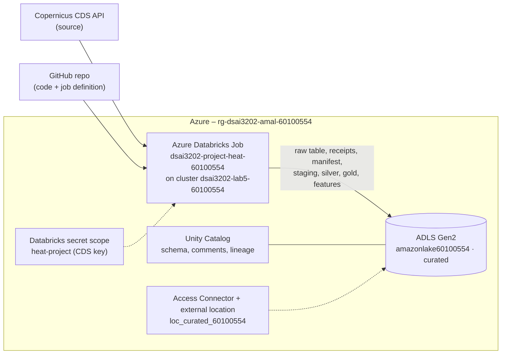

# Predicting tomorrow's heat stress in Doha – Phase 1: data pipeline, ETL and features

DSAI3202 Fall 2026 · Individual project · Amal Haji – 60100554
**Submitted commit / release:** tag `v1.0-phase1` – commit ⟨TODO: paste `git rev-parse HEAD`⟩

---

## Project and hypothesis

**Problem.** Qatar's rules stop outdoor work when the wet-bulb globe temperature (WBGT) is above **32.1 °C**. Site
managers plan tomorrow's outdoor work today. The system predicts **tomorrow's maximum WBGT in Doha** from today's
weather around Qatar and flags days likely to go above 32.1 °C.

**Target.** `target_wbgt_max_next_day` – the highest hourly WBGT in Doha on day D+1 (Qatar local day), calculated from
temperature and dewpoint with the simplified Bureau of Meteorology formula `WBGT = 0.567·T + 0.393·e + 3.94`
(e = vapour pressure, hPa).

**Baseline plan.** Persistence – "tomorrow = today" – stored as `baseline_persistence` in the feature table.

**Hypothesis (Part 0, unchanged).** A random forest / gradient-boosted model using today's weather from several
locations around Qatar will predict tomorrow's maximum WBGT in Doha with an MAE at least **10 % lower** than the
persistence baseline on the May–October days of 2022–2025. A smaller improvement refutes it.

**Refinements.** Topic, dataset, target, baseline, metric and threshold are unchanged from Part 0. Implementation changes:
1. Part 0 mentioned possibly reusing Data Factory; ingestion is done in the Databricks job instead, because the
   Copernicus API queues requests (sometimes for hours) and the `cdsapi` client handles this.
2. The course workspace only has external locations for the `curated` and `processed` containers (not `raw`), and the
   cluster blocks copying local files into the lake. The raw zone is therefore a separate, append-only area inside
   `curated`: original zip bytes in the Delta table `heat_raw_era5_files` plus receipts and a manifest in
   `curated/heat_project/raw/`.

---

## Dataset and architecture

| Item | Value |
|---|---|
| Dataset | ERA5 hourly time-series data on single levels from 1940 to present (Copernicus C3S), DOI 10.24381/1cf1ad76 |
| Source link | https://cds.climate.copernicus.eu/datasets/reanalysis-era5-single-levels-timeseries |
| Licence | CC-BY 4.0 (free account, licence accepted in the CDS profile) |
| Selection | 35 grid points (lat 24.50–26.00, lon 50.75–51.75, step 0.25°), hourly, 1980-01-01 → 2025-12-31 |
| Variables | 2 m temperature, 2 m dewpoint, 10 m wind (u, v), surface pressure, solar radiation, total cloud cover |
| Format | CSV delivered zipped, one file per grid point |
| **Measured size** | **442,828,468 bytes compressed (35 zips, ≈ 443 MB) · 1,356,019,575 bytes uncompressed CSV (≈ 1.36 GB)** |
| Rows | 14,113,680 hourly rows (35 points × 403,248 hours) |
| Version | `source_version=v1`; Delta versions per run are logged in `heat_run_log` |

**Ingestion mode and refresh.** Batch: one API request per grid point, all 35 submitted at the same time. The period
is historical and final, so it is ingested once. A refresh (e.g. adding 2026) runs the job with `source_version=v2`;
rows of `v1` are never changed.

**Storage layout** (lake `amazonlake60100554`, container `curated`, Unity Catalog `dsai3202_databricks.s_60100554`)
```
curated/heat_project/
  raw/                                   <- RAW ZONE (append-only)
    era5_timeseries/source_version=v1/
      _manifest.json                     <- identity, request, bytes, SHA-256 of all 35 files
      lat25.25_lon51.50/_receipt.json    <- one receipt per file
    test_inputs/bad_sample_v1/era5_bad_sample.csv   <- separate test input
  delta/
    heat_raw_era5_files                  <- original zip bytes + sha256 (key: source_version, point_id)
    heat_staging_era5                    <- unzipped rows, all text (rebuildable)
    heat_silver_weather_hourly | heat_silver_weather_rejects
    heat_gold_daily_weather | heat_features_v1 | heat_run_log
    *_test tables                        <- written only by test-mode runs
```

**Schema and lineage.** Columns, types, keys, assumptions and raw → processed links:
[`docs/catalog_and_lineage.md`](docs/catalog_and_lineage.md). All tables are registered in Unity Catalog with table and
column comments. Feature definitions: [`features/features_v1_spec.yaml`](features/features_v1_spec.yaml).

**Architecture**

| Service | Role |
|---|---|
| Azure Databricks job (5 tasks) | ingestion, ETL, quality gate, gold and features |
| ADLS Gen2 `amazonlake60100554` (`curated`) | raw zone, receipts/manifest and all Delta tables |
| Unity Catalog | table registration, column documentation, lineage |
| Access Connector / external location | managed-identity access from Databricks to the lake (no keys in code) |
| Databricks secret scope `heat-project` | holds the CDS API key |
| GitHub | notebooks are pulled from the repo by the job (`git_source`) |

---

## Run the pipeline

**Prerequisites and permissions**
1. Copernicus CDS account; accept the **CC-BY licence** (profile → Dataset licences); copy your API token.
2. Databricks workspace `dsai3202-databricks`, cluster `dsai3202-lab5-60100554`, `USE CATALOG` on
   `dsai3202_databricks`, `CREATE TABLE` on `s_60100554`, and access to external location `loc_curated_60100554`.
3. GitHub linked in Databricks (*Settings → Linked accounts*) with the Databricks GitHub app allowed on this repo.

**Dependencies.** Databricks Runtime of the course cluster (pyspark, pandas, matplotlib) + `cdsapi>=0.7.4`
(installed by the job task). See [`requirements.txt`](requirements.txt). Local unit tests: `python tests/test_heat_formulas.py`.

**Configuration (no secrets in the repo).** Names are in [`conf/project_config.json`](conf/project_config.json).
Store the CDS key once from a temporary notebook **outside** the repo, then delete that notebook:
```python
from databricks.sdk import WorkspaceClient
w = WorkspaceClient()
w.secrets.create_scope(scope="heat-project")
w.secrets.put_secret(scope="heat-project", key="cds-api-key", string_value="<your CDS token>")
```
Upload `tests/data/bad_sample_v1/era5_bad_sample.csv` to `curated` → `heat_project/raw/test_inputs/bad_sample_v1/`
(portal *Storage browser → Upload → Advanced → Upload to folder*).

**Execution**
1. *Workspace → Create → Git folder* → this repo.
2. Open `notebooks/07_create_and_run_job`, attach the cluster, run cells 1–2: they create the job from
   [`jobs/heat_pipeline_job.json`](jobs/heat_pipeline_job.json) using the existing cluster. Cell 3 starts a prod run.
3. Job page → **Run now** (prod run, and again for the rerun) and **Run now with different parameters →
   `run_mode = test`** (controlled failure). Max concurrent runs = 2.
4. Run `notebooks/06_eda` and export it as HTML.

Task order: `01_ingest → 02_silver → 03_validate → 04_publish_gold → 05_features` (04 and 05 run only if 03 passes).

---

## Results and features

**Runs** (from `heat_run_log`, full export: [`docs/evidence/run_log.csv`](docs/evidence/run_log.csv); job id `277959603038648`)

| Run | run_id | Result | Evidence |
|---|---|---|---|
| 1 – prod | `238429206358541` | all 5 tasks succeeded; 35 files downloaded; 13 min 30 s | [screenshot](docs/evidence/job_run_prod_1.png) |
| 2 – safe rerun | `350098257976649` | all tasks succeeded; `downloaded_this_run = 0`, `skipped_already_present = 35`; identical row counts | [screenshot](docs/evidence/job_run_prod_2_rerun.png) |
| 3 – test | `835995305781747` | `03_validate` FAILED on `reject_rate_ok`; 04/05 not run | [graph](docs/evidence/job_run_test_failed.png), [error](docs/evidence/run3_validate_error.png) |

Other runs in the log are development attempts made while fixing cluster permissions and memory (e.g. `730331893065075`
ran out of driver memory in 02_silver, which led to the worker-side unzip described below).

**Output paths and versions**

| Output | Table | Delta version after run 1 → run 2 |
|---|---|---|
| Raw | `heat_raw_era5_files` + [`_manifest.json`](docs/evidence/_manifest.json) | append-only, 35 rows for `v1` (unchanged by run 2) |
| Silver | `heat_silver_weather_hourly` | 0 → 12 |
| Gold | `heat_gold_daily_weather` | 0 → 6 |
| Features | `heat_features_v1` | 0 → 5 |

(Version numbers rise by more than one per run because comments are also written to the tables.)

**Row accounting** – input = accepted + rejected + duplicates_dropped

| Run | Input | Accepted | Rejected (by reason) | Duplicates dropped | Balanced |
|---|---|---|---|---|---|
| 1 / 2 (prod) | 14,113,680 | 14,113,470 | 210 (`out_of_range` 210) | 0 | ✅ |
| 3 (test) | 116 | 96 | 10 (`missing_required` 4, `cast_failed` 3, `out_of_range` 3) | 10 | ✅ |

Quality gate run 1: reject rate 0.001 %, 35/35 points, minimum completeness 99.9985 %, no duplicate keys → **PASSED**.
Gold: 588,105 daily rows → **587,825** complete days kept, 280 incomplete days dropped (first/last day of each point because
of the UTC+3 shift, plus a few days with missing hours). Features: **16,781** rows (train 13,863 · validation 1,461 ·
test 1,457), 14 rows dropped for missing previous/next day.

**When a quality failure stops publication.** `03_validate` stops the job, leaving gold and features unchanged, if:
row accounting is not balanced · reject rate > 1 % · duplicate keys in silver · not all 35 points (incl. Doha) present ·
any point has < 99 % of expected hours. Row rules in `02_silver`: values that cannot be read as numbers/timestamps
(`cast_failed`), missing time/location/temperature/dewpoint (`missing_required`) and physically impossible values
(`out_of_range`, e.g. temperature outside −10…60 °C, dewpoint above temperature, pressure outside 850–1100 hPa) go to
`heat_silver_weather_rejects`; duplicate keys keep one row. Missing optional values (wind, pressure, radiation, cloud)
stay null.

**Safe rerun.** Run 2 skipped all 35 stored raw files (nothing downloaded, appended or overwritten) and rebuilt silver,
gold and features deterministically with exactly the same counts; Delta history keeps the earlier versions.

**Controlled failure.** Separate test input [`tests/data/bad_sample_v1/`](tests/data/bad_sample_v1/) (made by
[`tests/make_bad_sample.py`](tests/make_bad_sample.py)): 116 rows with 10 duplicates, 4 missing temperatures, 3 text values
in number columns and 3 impossible values. 10 rejected = 8.6 % > 1 % → publication stopped. Test runs write only to `*_test` tables.

**EDA findings** (full population, **no sampling** – [`06_eda.html`](docs/evidence/06_eda.html))
- **Populations:** 14,113,470 silver hourly rows · 35 grid points · 210 rejected rows · 587,825 gold daily rows · 16,781 feature rows.
- **Hourly values:** temperature mean 27.1 °C (min −0.3, max 51.0); dewpoint mean 17.2 °C; relative humidity mean 59 %.
- **Target:** next-day max WBGT has two peaks – a winter peak around 24 °C and a summer peak around 35 °C. Alert days
  (> 32.1 °C) never happen January–March, are rare in April (0.5 %), then rise to 38 % of May days, 85 % of June days
  and about 99 % of July and August days.
- **Trend:** alert days per May–October season rose from roughly 105–140 in the 1980s to roughly 140–165 since 2015.
- **Correlations with the label:** region mean max WBGT 0.977, Doha max WBGT today 0.974, Doha max temperature 0.944,
  region dewpoint 0.894, Doha dewpoint 0.855, season (`doy_cos`) −0.811; wind components are weak (−0.28 to 0.15) and the
  1-day pressure change is almost unrelated (−0.05).
- **Outliers:** IQR rule on hourly WBGT gives bounds 6.1–49.0 °C; only 30 hours fall outside. They are cold winter nights
  inland, physically possible, so they are kept.
- **Persistence:** today vs tomorrow lie close to the diagonal (May–Oct); persistence MAE: train **0.941 °C** (6,986 days) ·
  validation **0.912 °C** (736 days) · test **0.958 °C** (736 days). To support the hypothesis, the Phase 2 model must reach
  a test MAE of **≤ 0.862 °C** (10 % below 0.958).

**Effect on readiness for modelling**
- *Persistence is a strong baseline* (r = 0.974), so a 10 % MAE improvement is a demanding target – the hypothesis may
  well be refuted, which is an acceptable scientific outcome.
- *Warming trend* → the test years (2022–2025) are hotter than most training years; the chronological split keeps this
  realistic, but the model may under-predict. Phase 2 will compare errors per year.
- *Imbalance for the alert flag*: in July–August almost every day is an alert day, so alert accuracy there is trivial;
  the main metric stays MAE on May–October, where the useful decisions are in May, June, September and October.
- *Strongly correlated features* (Doha vs region WBGT, temperature, dewpoint) – fine for tree models, but feature
  importances must be read with care.
- *Data risks:* simplified shade WBGT (no sun/wind term), ERA5 is a reanalysis not a station, and the Doha 0.25° cell
  partly covers sea. The data itself is clean (0.0015 % rejected, 99.9985 % complete), so it is ready for Phase 2.

**Initial features** – full definitions, types, sources and availability: [`features/features_v1_spec.yaml`](features/features_v1_spec.yaml)

| Feature | Type | Source | Available at prediction time |
|---|---|---|---|
| doha_wbgt_max, doha_wbgt_change_1d | double °C | gold, Doha | yes – day D / D-1 |
| doha_t_max, doha_td_mean | double °C | gold, Doha | yes – day D |
| doha_u_mean, doha_v_mean | double m/s | gold, Doha | yes – day D |
| doha_sp_change_1d | double hPa | gold, Doha | yes – day D / D-1 |
| region_wbgt_max_mean, region_td_mean | double °C | gold, 35 points | yes – day D |
| region_u_mean, region_v_mean | double m/s | gold, 35 points | yes – day D |
| doy_sin, doy_cos | double | date | yes |

**Leakage risks:** a feature taken from day D+1; a random split; scalers fitted on all years; mixing UTC and Qatar days
(would leak 3 hours of tomorrow). The first, second and fourth are prevented in code; the third is a rule for Phase 2.
No feature selection in v1 (features chosen for physical reasons). **Sample for modelling:** none – all 16,781 rows are used.

---

## Resource use and contributions

**Performance choice (measured): parallel submission + worker-side unzipping.**
- All 35 CDS requests are submitted **at the same time**, so they wait in the Copernicus queue together instead of one
  after another. Each file is ~12.6 MB and the queue, not computing, dominates; with sequential requests the wait would
  multiply by 35.
- Unzipping first ran on the **driver** one file at a time; development run `730331893065075` crashed with
  *"driver … ran out of memory"* after ~20 min. Moving the unzip to the **workers** (`mapInPandas`, one point per
  partition) fixed it: rerun `350098257976649` finished the whole pipeline in **≈ 7 min** (run 1, including downloads:
  13 min 30 s).
- Storage: 443 MB of raw zips → 1.18 GB silver Delta → 60.5 MB gold Delta (logged by `04_publish_gold`); features are
  16,781 rows, so Phase 2 modelling is cheap.
- Cost estimate (from list prices, not from the billing page): the job ran on the existing course cluster
  (1 driver + 2 workers, all Standard_D4s_v3). Pipeline compute: run 1 ≈ 13.5 min, run 2 ≈ 7 min, run 3 ≈ 1 min, plus ≈ 45 min of
  development runs – about **1.1 hours of pipeline time**; the cluster was switched on for ≈ 4 hours in total that day
  (setup, debugging, EDA). Assuming ≈ $0.65 per node-hour (D4s_v3 VM ≈ $0.25/h + 0.75 DBU × ≈ $0.55
  all-purpose DBU), 3 nodes ≈ **$2.0 per hour** → pipeline runs ≈ **$2.2**, whole day ≈ **$8**. A rerun now costs
  ≈ $0.25 (≈ 7 min). The biggest saving available is turning the cluster off when idle (auto-termination) and, in
  Phase 2, using a single-node job cluster, since the feature table is only 16,781 rows.

**Cleanup.** The cluster auto-terminates when idle; stop it after the runs. After grading: drop the `*_test` tables and
`heat_staging_era5` (rebuildable from the raw table); keep the raw table, receipts, silver/gold/features and the job for
Phase 2. Shared course resources are kept as instructed.

**Contributions.** Individual project – all work by Amal Haji (60100554).

**Reused code and adaptations.** The prepare → validate → publish job structure follows my Lab 6 job
(`dsai3202-lab6-60100554`); the silver cleaning idea follows Lab 5 (`01_silver.py`); the lake, Access Connector and
Unity Catalog schema are the course resources from Labs 3–6. Changes for this dataset: API ingestion with an
append-only raw table, SHA-256 receipts and a manifest; weather-specific type, range and duplicate rules with a rejects
table and row accounting; Qatar time zone and WBGT calculation; daily gold table; a time-series feature table with a
next-day label.

---

## AI use

| Tool | Request | Response | My changes |
|---|---|---|---|
| Claude (Anthropic) | Suggest Qatar-related topics and help with the Part 0 hypothesis. | Topic ideas and drafts of the Part 0 document. | Reworded and simplified it (see Part 0). |
| Claude (Anthropic) | Do Phase 1 from the brief and guide me step by step through Azure and the code; fix the errors I hit while running it. | The repository code (notebooks, formulas, tests, test input, job definition, config, feature spec, catalog doc), fixes for the permission/memory errors, and this README text including the EDA write-up from my outputs. | I chose the final topic (heat stress) after rejecting harder options, and did all the setup and running myself: created the Copernicus account and accepted the licence, stored the API key as a Databricks secret, created the GitHub repo and pushed every change, linked GitHub to Databricks and allowed the app on the repo, uploaded the test file, created the job and ran it. I found each error while running (missing licence, lake permissions, malformed test values, temp-folder permission, driver out of memory), reported them and applied and tested the fixes. I ran the EDA, collected all evidence, and checked the README numbers against my run log. |
