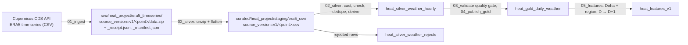

# Catalog, schema and lineage

All tables are registered in **Unity Catalog** under `dsai3202_databricks.s_60100554` as external Delta tables in the
lake (`curated/heat_project/delta/...`). The notebooks set table and column comments; Unity Catalog records lineage for
the job runs automatically (Catalog Explorer → table → *Lineage*).

## Lineage (raw → processed)

## Tables

### `heat_silver_weather_hourly` — key: (latitude, longitude, valid_time_utc)
| Column | Type | Description / unit | From raw |
|---|---|---|---|
| latitude, longitude | double | grid point (0.25°) | request location |
| point_id | string | e.g. `lat25.25_lon51.50` | derived |
| valid_time_utc | timestamp | hour in UTC | `valid_time` |
| time_qa / date_qa / hour_qa | timestamp / date / int | Qatar local time (UTC+3) | derived |
| t_c, td_c | double | temperature, dewpoint, °C | `t2m`, `d2m` − 273.15 |
| u10_ms, v10_ms | double | wind components, m/s | `u10`, `v10` |
| sp_hpa | double | surface pressure, hPa | `sp` / 100 |
| ssrd_wm2 | double | mean solar radiation over the hour, W/m² | `ssrd` / 3600 |
| tcc | double | cloud cover 0–1 | `tcc` |
| rh_pct | double | relative humidity, % | from t_c, td_c |
| wind_speed_ms, wind_dir_deg | double | wind speed; direction it blows from | from u, v |
| wbgt_c | double | simplified shade WBGT, °C | 0.567·T + 0.393·e + 3.94 |
| source_version, run_id | string | data version and producing run | job |

### `heat_silver_weather_rejects`
Original text values of each rejected row + `source_file`, `reject_reason` (`cast_failed`, `missing_required`, `out_of_range`), `run_id`.

### `heat_gold_daily_weather` — key: (point_id, date_qa)
Complete 24-hour Qatar days per point: `n_hours`, `wbgt_max_c`, `wbgt_mean_c`, `t_max_c`, `t_min_c`, `t_mean_c`, `td_mean_c`,
`rh_mean_pct`, `u_mean_ms`, `v_mean_ms`, `wind_max_ms`, `sp_mean_hpa`, `ssrd_max_wm2`, `tcc_mean`, `hours_above_threshold`,
`source_version`, `run_id`.

### `heat_features_v1` — key: date_qa
See [`features/features_v1_spec.yaml`](../features/features_v1_spec.yaml).

### `heat_run_log`
One row per task per run: `run_id`, `run_mode`, `source_version`, `task`, `status`, `logged_at`, `metrics_json`.

## Assumptions
- ERA5 is a reanalysis (model + observations), used as the best available weather record; it is not a station measurement.
- Each 0.25° cell covers about 28 km × 25 km; the Doha cell (25.25, 51.50) partly covers sea.
- WBGT uses the simplified Bureau of Meteorology formula (shade only), so it estimates the regulated outdoor WBGT.
- 1980–2025 data is final ERA5, not the preliminary ERA5T release.
